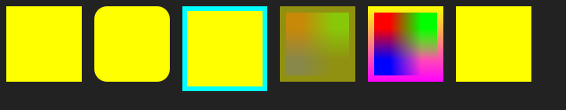
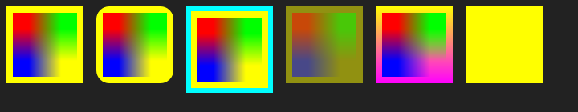
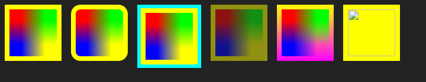

# Host UI core corrections — 2026-11-01

Scope: pointer inheritance and replaced-image solid-background ordering in the
shared C++ core. No ABI change. JPEG decoding, late asset diagnostics and host-engine
SDK adoption remain separate work; this is not a host-game acceptance claim.

## Behavior and failed baselines

The pointer registry marked `pointer-events` non-inherited. The seven-case matrix
checks default inheritance, `auto`, `inherit`, `initial`, `unset`, and changing the
parent back and forth. It verifies computed style, hit targets and delivered clicks,
including a child opting back in with `auto`. Pinned Chrome 152.0.7977.82 passes all
seven. Unchanged native production code fails nine assertions; changing only the
registry inheritance flag passes. The stale registry comment referred to the C#
implementation deleted in September; it now identifies the C++ source of truth.

A solid background was emitted after replaced content; layered backgrounds already
painted first. The shared paint path now draws the pending solid fill before the
image. Six draw-order regressions fail before the fix and pass after it: plain,
rounded, padded/bordered, translucent, transformed, and overflow-clipped images.
The existing decoration path still handles borders and outlines.

## Render inspection

These actual 720x140 captures were inspected. The 2x2 PNG contains red, green,
blue and transparent white texels. Six images show a plain yellow background,
rounded corners, cyan border, opacity .5, gradient, and missing-file control.

Before:

After:

Pinned Chrome:

The first three pictures now remain visible over their backgrounds; transparent
texels reveal the fill and padding/borders remain visible. The existing gradient
case is unchanged. This is not pixel-perfect browser parity: the opacity .5 case
has a separate group-compositing difference, Chrome shows a missing-image symbol,
and one sampled gradient channel differs by one byte. Those differences were not
hidden by widening a tolerance. Original fixture, captures and logs remain in
`.utmp/host-ui-20261101/`.

## Verification

| Check | Result |
| --- | --- |
| Windows core | 596,586 checks, zero failures |
| GCC | 18/18 CTest suites; core 596,586 checks |
| Clang ASan/UBSan | 20/20 CTest suites; core 596,580 checks (small-stack exclusions) |
| Pinned Chrome pointer behavior | 7/7 cases, computed/hit/click checks |
| Cached property IDs | zero unknown IDs |
| Unity Native EditMode | 258 pass, zero failures, two existing environment-gated inconclusive |
| Godot input integration | 43 checks, zero failures |
| Godot host suite | 247 checks, zero failures; expected malformed-CSS warning |

GCC, Clang and both host builds emitted zero compiler warnings. Unity's candidate
DLL SHA-256 is `4ed3c4282c5dc50ae1306074a8d7c6e3430b15d8f204e3c7d6d6afd75985d70a`.
The first Unity run accidentally loaded the old package DLL because the build
output directory was not the plugin installation directory. That run is **not**
candidate evidence. After installing and hash-checking the rebuilt DLL, the
independent `unity-native-candidate.xml` run produced the result above (exit 2,
zero failed tests). Both runs are retained. No full rendering, full Chrome corpus,
full Unity EditMode or end-to-end game performance result is claimed here.
